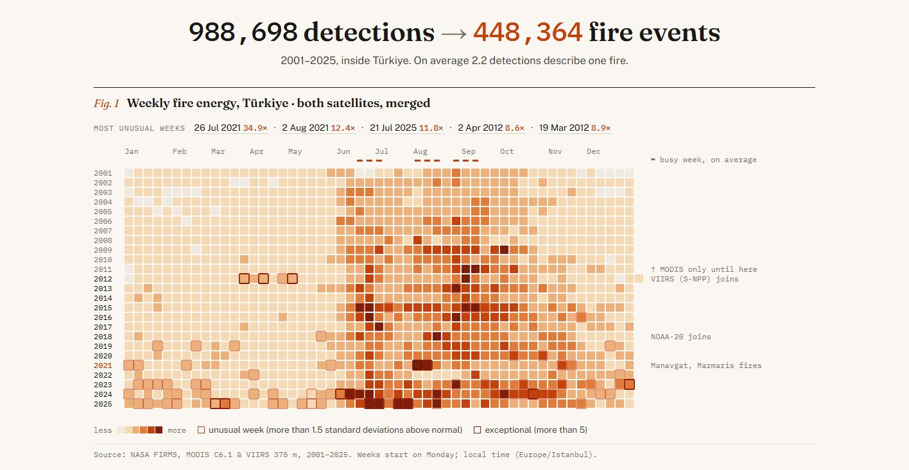

# The Fire Almanac of Türkiye — MODIS + VIIRS hot spot harmonization

**NASA Space Apps Challenge 2026 · Harmonization of MODIS and VIIRS Hot Spots**

Live app: **https://orhanizmirli.github.io/modis-viirs-harmonize/** — *When does Türkiye burn?*

MODIS (1 km, since 2000) and VIIRS (375 m, since 2012) both map active fires, but they
see the same fire differently: different pixel sizes, overpass times, confidence scales
and sensitivity. Counting their hot spots side by side double-counts big fires and
hides the fact that VIIRS sees many small fires MODIS cannot. This project turns both
archives into **one harmonized set of fire events** and shows it as a
**burn-activity calendar** for any province or any rectangle drawn on the map.



## Results at a glance

Numbers are for detections and events inside Türkiye's 81 provinces (the download box also
covers parts of neighbouring countries; those events are kept in the files but not counted here).

| | |
|---|---|
| Raw FIRMS rows (Area API, Türkiye bounding box, 2001–2025) | 2,054,986 |
| Vegetation-fire detections inside Türkiye | **988,698** (232,808 MODIS · 755,890 VIIRS) |
| Harmonized fire events inside Türkiye | **448,364** (2.2 detections per event) |
| Seen by both sensors / MODIS only / VIIRS only | 7.8% / 22.9% / 69.2% of events (8.7% of fire-days seen by both) |
| Most unusual week, Türkiye, fire energy | **26 Jul – 1 Aug 2021**: 601,798 MW, 35× the 2012–2025 mean for that week (z = 54); next: 2–8 Aug 2021 (z = 17) |
| Yearly fire energy vs global temperature (NASA GISTEMP) | MODIS record, 2001–2025: Pearson r = 0.10 (p = 0.64), no detectable relationship; no significant trend in total FRP |

**The 2021 check.** Summer 2021 (Manavgat, Marmaris) is the strongest anomaly in the
whole archive when activity is measured as fire energy. Nationally, however, it is
**not** unusual in *event counts* (z between −1.3 and −0.2 for weeks 29–31): Türkiye has
thousands of small agricultural fires every summer, and the harmonization collapses each
mega-fire into a single event. In Antalya and Muğla the weeks stand out in both metrics
(event-count z = 5.6–33, FRP z = 200–714). This is why the calendar measures fire energy
by default. See `figures/calendar_2021_check.png`.

## What the app does

A single scrolling page, written for people rather than analysts:

1. **The calendar** (Figure 1): one row per year (2001–2025), one cell per week.
   Darker cells mean more fire. Weeks that were unusual for their time of year carry a thin
   red outline; hovering shows e.g. *"Unusual activity: 34.9× the long-term average"*.
   On first load, the page draws attention to the summer-2021 weeks. Region: any of the
   81 provinces, Türkiye as a whole, or a rectangle drawn on the map. Measure: fire
   energy (FRP), active fires or new fires. Sensors: **both satellites (harmonized)**,
   MODIS only or VIIRS only, so the effect of harmonization is visible. Below it, a
   month-by-month chart and a week-by-week comparison of the three sensor views.
2. **What two satellites saw**: the same day and area (29 July 2021, Manavgat) before
   and after merging. 1,540 raw detections become 3 fire events.
3. **The live map**: the fires of the selected week, coloured by *seen by both
   satellites / MODIS only / VIIRS only*. Click a fire to get a plain-language story
   ("This fire burned in Antalya province for 10 days… Both satellites confirmed it."),
   its **Trust Score** ("Trust Score: 77% — confirmed by two satellites"; the fused
   confidence below, shown as a percentage), an overpass timeline (which satellite saw it, when) and collapsible
   technical details (fused-confidence terms, detections, FRP).
4. **Is this week normal?** Above the calendar, one sentence computed for the current
   calendar week and the selected region. It counts the years in which that week stayed below
   its long-term average, over the selected view's own baseline: 2012–2025 for the harmonized
   and VIIRS views (VIIRS joined in 2012; earlier merged years are MODIS only and not
   comparable), 2001–2025 for MODIS only. The wording follows the count: "usually calm" (≥ 60%
   of years below average), "usually busy" (≤ 40%) or "mixed". It is hidden when it cannot be
   computed.
5. **Who is this for?** and **Download the data** (events GeoJSON, daily calendar CSV, all
   detections CSV, with field descriptions).
6. **Before the season**: for a selected critical week, a short sourced note on the fire
   season, prevention and the stubble-burning ban, plus "Did you know?" cards taken from
   the FireWatch TR verified facts pool.

**Accessibility.** A *colorblind-safe colors* switch above the calendar swaps the heatmap to
a viridis-like ramp and the sensor colors to the Okabe–Ito palette (the default palette was
also checked for colour-vision deficiency separation). Every calendar cell, bar and map circle
has a numeric tooltip, and figures carry text alternatives (`aria-label`).

Everything is static (vanilla JS + Leaflet, no build step, no server). Data lives in
`docs/data/` as JSON. `src/make_story.py` builds the small `story.json` used by section 2
from the pipeline outputs.

## NASA data

| Product | Sensor / satellites | Resolution | Used period |
|---|---|---|---|
| MODIS Collection 6.1 active fires (MCD14ML, FIRMS `MODIS_SP`) | Terra + Aqua | 1 km at nadir | 2001–2025 |
| VIIRS 375 m active fires (VNP14IMG, FIRMS `VIIRS_SNPP_SP`) | Suomi NPP | 375 m | 2012–2025 |
| VIIRS 375 m active fires (VJ114IMG, FIRMS `VIIRS_NOAA20_SP`) | NOAA-20 | 375 m | 2018–2025 |
| VIIRS 375 m active fires (VJ214IMG, FIRMS `VIIRS_NOAA21_SP`) | NOAA-21 | 375 m | 2023–2025 |

Source: NASA FIRMS (Fire Information for Resource Management System),
<https://firms.modaps.eosdis.nasa.gov/>. Standard-processing (science-quality) archive.

| Climate product | Provider | Resolution | Used period |
|---|---|---|---|
| GISTEMP v4 global land-ocean temperature anomaly (annual J-D, vs 1951–1980) | NASA GISS | global mean | 2001–2025 |

Source: NASA Goddard Institute for Space Studies, <https://data.giss.nasa.gov/gistemp/>
(open CSV `tabledata_v4/GLB.Ts+dSST.csv`, no key; copy in `data/gistemp/`). Used only for
the climate comparison figure.

**How the data was fetched.** `src/fetch_firms.py` downloaded the four standard-processing
sources (`MODIS_SP`, `VIIRS_SNPP_SP`, `VIIRS_NOAA20_SP`, `VIIRS_NOAA21_SP`) through the FIRMS
**Area API** for the Türkiye bounding box (25.6–44.9 E, 35.8–42.2 N), 2001–2025, in 3,621 five-day
requests, all cached in `data/raw/`. FIRMS allows 5,000 transactions per 10 minutes and a
five-day request costs about ten, so the script pauses whenever the budget is spent (FIRMS
then answers "Invalid MAP_KEY"). NOAA-21 data start in March 2023. `src/fetch_archive.py`
(FIRMS yearly country files, no key) is kept as a fast alternative input.

## Method

All constants live in [`src/harmonize.py`](src/harmonize.py) and are covered by tests.

### 1. Common schema
Every FIRMS row becomes: `lat, lon, time_utc, sensor, satellite, frp_mw, footprint_km2
(= scan × track), frp_mw_per_km2, day_night, confidence_raw, confidence_class,
confidence_score`. Exact duplicates are dropped. Rows that FIRMS flags as
non-vegetation fires are removed: `type` 1 volcano, 2 static land source (industry, gas
flares) and 3 offshore. Only `type` 0 (presumed vegetation fire) is kept.

### 2. Confidence normalization
* **MODIS C6.1** gives 0–100. Classes follow the MODIS Collection 6.1 Active Fire
  Product User's Guide (Giglio, Schroeder, Hall & Justice; also the FIRMS FAQ):
  **low < 30, nominal 30–79, high ≥ 80**. Score = confidence / 100.
* **VIIRS 375 m** gives classes `l / n / h` (Schroeder & Giglio, VIIRS 375 m Active Fire
  Product User's Guide). Score = midpoint of the matching MODIS band:
  **l = 0.15, n = 0.55, h = 0.90**.

So both sensors share one 0–1 score and the same three classes.

### 3. Resolution
The footprint area is `scan × track` (km²). MODIS pixels grow from 1 km² at nadir to
about 10 km² at the swath edge; VIIRS from 0.14 km² to about 0.6 km². FRP is reported
both in MW and in **MW/km²**, so a 1 km MODIS pixel and a 375 m VIIRS pixel can be
compared.

### 4. Cross-sensor matching → fire events
Two detections belong to the same fire when

```
distance(i, j) < r_i + r_j + 0.375 km     and     |t_i − t_j| ≤ 12 h
```

with `r = ½·√(scan² + track²)`, the radius of the circle around the pixel. The
0.375 km tolerance is one VIIRS I-band pixel and absorbs geolocation error. Candidate
pairs come from a 3-D KD-tree (x, y, scaled time). Then a **union-find** (connected
components) chains every linked pair into a *fire event*. A fire that keeps burning is
linked overpass to overpass across days. A field burned again three weeks later becomes
a new event.

The same rule is applied to all detections (harmonized), to MODIS alone and to VIIRS
alone. That is what the app's sensor-comparison switch shows.

### 5. Events and fused confidence
Each event has `event_id, centroid, first_seen, last_seen, sensors[], n_modis, n_viirs,
max_frp, harmonized_confidence, agreement (both / modis_only / viirs_only)` and its province
(point-in-polygon on geoBoundaries ADM1).

```
base      = mean confidence score of the event's detections
c         = base + 0.30·(1 − base)·[MODIS and VIIRS both saw it]
                 + 0.10·(1 − base)·[seen on ≥ 2 distinct overpasses]
c         = clip(c, 0, 1)
c(t)      = c · 0.5^((t − last_seen) / 24 h)          (staleness, shown "as of" a day)
```

In the app, `c` is shown as the event's **Trust Score** (0–100%).

A second sensor removes 30% of the remaining doubt, and repeated observation removes
10% more. Confirmation can only raise confidence. When an event is viewed on a later
day, its confidence halves every 24 h without a new detection.

### 6. Calendar aggregation
Per region (Türkiye + 81 provinces) and **local day** (Europe/Istanbul):
`events` (active that day), `new_events`, `frp_mw`, `det_modis`, `det_viirs`, and for
harmonized also the agreement split. Weekly anomaly: for each week of the year, mean and
standard deviation over the **other** years of the baseline (leave-one-out, so an extreme
year does not hide itself in its own mean). Baseline: 2001–2025 for MODIS only,
2012–2025 for VIIRS only and harmonized. `z > 1.5` (and at least 3 events / 100 MW)
→ *unusual activity*.

### Outputs
| File | Content |
|---|---|
| `output/events.geojson(.gz)` | harmonized fire events |
| `output/calendar_daily.json` | region × day calendar for all three modes, plus unusual weeks |
| `output/detections_harmonized.csv(.gz)` | every detection in the common schema with its event id |
| `docs/og.png` | social preview image (almanac cover), also from `src/present_figures.py` |
| `output/calendar_daily.csv.gz` | the same calendar as a flat CSV (`src/export_csv.py`) |
| `output/summary.json`, `output/validation.json` | counts and validation numbers |
| `docs/data/` | the same data cut into small static files for the web app |

The plain `events.geojson` and `detections_harmonized.csv` are over GitHub's 100 MB file
limit, so the repository holds the `.gz` copies. Running the pipeline recreates both.

## Validation

All numbers come from `output/validation.json` (written by `src/validate.py`).

| Figure | What it shows | Result |
|---|---|---|
| `figures/match_rates.png`, `figures/slide_match_rates.png` | Share of each sensor's detections matched by the other sensor (2012+), day vs night, for the 12 h event rule and for near-simultaneous (≤ 1 h) passes | MODIS→VIIRS: **56% day / 62% night** (≤ 12 h), 41% / 22% (≤ 1 h). VIIRS→MODIS: 27% day / 31% night (≤ 12 h): most VIIRS detections are fires too small for MODIS |
| `figures/frp_scatter.png`, `figures/slide_frp_scatter.png` | FRP of Aqua vs S-NPP/NOAA-20 for the same event, passes ≤ 30 min apart | n = 25,171 pairs; **Pearson r (log) = 0.69**, Spearman ρ = 0.63, log-log slope 0.78; median VIIRS/MODIS ratio 0.81 (day r = 0.69, night r = 0.74) |
| `figures/dedup.png`, `figures/slide_dedup.png` | Raw detections vs harmonized events per year (whole download box) | 1,423,446 → 598,750 (**2.4×**); the ratio rises after 2012, 2018 and 2023 as VIIRS satellites add repeat looks |
| `figures/small_fire_example.png` | FRP distribution of VIIRS-only vs both-sensor events, and one small fire missed by MODIS | VIIRS-only events: median max FRP **3.8 MW** vs 20.2 MW for both-sensor events. Example H478349 (Ankara, 24–25 Oct 2023): 4 VIIRS detections on 4 passes, max 0.9 MW, **no MODIS detection within 15 km** |
| `figures/insight.png` | Season start/end/length and total FRP per year, single-sensor records, Theil–Sen + Kendall **No significant trend in total FRP** (p = 0.50 / 0.91). The 10–90% season-length statistic also shows a positive slope, but it is not used as a result (see Limitations) |
| `figures/calendar_2021_check.png`, `figures/slide_2021_unusual.png` | Türkiye 2021 weekly totals vs leave-one-out mean | FRP weeks 30–31: z = 54 and 17; event counts: not anomalous (see above) |

**Slide figures** (`src/present_figures.py`, 300 dpi, paper background):
`figures/slide_2021_unusual.png` (summer 2021 flagged in the calendar),
`figures/slide_before_after.png` (29 July 2021, Manavgat: 1,540 detections → 3 events),
`figures/slide_frp_scatter.png` (r = 0.69), `figures/slide_match_rates.png` and
`figures/slide_dedup.png` (raw detections vs fire events per year) and
`figures/slide_climate.png` (yearly fire energy vs NASA GISTEMP, r = 0.10).

`figures/slide_climate.png` compares NASA GISTEMP v4 global annual temperature anomaly with
Türkiye's yearly fire energy from the MODIS record (the only sensor-consistent series for
2001–2025): Pearson r = 0.10 (p = 0.64), Spearman ρ = 0.17 (p = 0.43), detrended r = −0.11.
The merged MODIS+VIIRS total gives r = 0.77, but that mostly reflects VIIRS satellites joining in
2012, 2018 and 2023, not fire. Correlation is reported, not causation. Values in `output/climate.json`.

## Run it

```bash
pip install -r requirements.txt
cp .env.example .env              # add your FIRMS MAP_KEY
python src/fetch_firms.py --region turkey --start 2001-01-01 --end 2025-12-31 \
       --sources VIIRS_SNPP_SP VIIRS_NOAA20_SP VIIRS_NOAA21_SP MODIS_SP   # Area API, cached in data/raw
python src/fetch_archive.py       # alternative: FIRMS yearly country files, no key, data/raw_archive
python src/pipeline.py --raw data/raw          # or --raw data/raw_archive
python src/validate.py            # figures/*.png and output/validation.json
python src/make_story.py           # data for the "two satellites" section
python src/export_csv.py           # calendar CSV for download
python src/present_figures.py      # slide figures
pytest -q
python -m http.server -d docs 8000             # open http://localhost:8000
```

`fetch_firms.py` reads the key only from `.env` (never printed), caches every request in
`data/raw/<SOURCE>/`, never sends the same request twice, and backs off when FIRMS reports
the transaction limit.

## Limitations

* **Detections are not fire reports.** Clouds, thick smoke and canopy hide fires; a fire
  can start and end between overpasses; small or cool fires go undetected (FIRMS FAQ).
* **The sensor record is not homogeneous.** VIIRS starts in 2012, NOAA-20 adds passes
  from 2018 and NOAA-21 from 2023, so VIIRS-based and harmonized
  *counts* rise partly because more satellites look. Anomalies are computed against the
  same mode's own baseline, the harmonized calendar marks the pre-2012 *MODIS-only era*,
  and the trend analysis uses single-sensor records only. Terra and Aqua have been
  drifting from their nominal overpass times since about 2020–2022, which can affect late
  MODIS years.
* **Event counts vs. energy.** Union-find merges a large fire into one event, so a
  catastrophic week can look ordinary in *event counts*. Nationally, 2021 Jul–Aug is
  below average in event count but by far the most extreme period in FRP. That is why
  the calendar defaults to FRP and offers counts as an alternative.
* **Linkage can chain.** Dense agricultural burning on the same day can join
  neighbouring fields into one event; persistent hot spots not flagged by FIRMS as static
  sources (some industry) can show up as long-lived small events.
* **Province = event centroid.** An event crossing a border counts for one province.
  Rectangle selection uses event centroids too.
* **Fixed thresholds.** 12 h / footprint + 0.375 km and the confidence weights are
  reasoned defaults, not fitted parameters; they are tested and easy to change.
* **Fire-season length is not a reliable trend here.** `validate.py` defines the season as
  the 10th–90th percentile of event start dates in each calendar year and counts all
  vegetation fires, agricultural burning included. In Türkiye that distribution is bimodal
  (small winter/spring and autumn burns vs the summer peak), so the 10% date jumps between
  modes (e.g. day 155 in 2011, day 46 in 2021) as the share of off-season small fires
  changes (Nov–Dec share of MODIS detections: about 4–10% before 2012, 15–30% after). The
  single-sensor record removes satellite additions but not Terra/Aqua orbit drift. The
  positive slope (MODIS +4.9 d/yr) is therefore kept as a diagnostic, not a result.
* **z-scores at low counts.** With 14 baseline years and skewed weekly totals, z > 1.5
  fires in roughly 10% of weeks; the ranked "most unusual weeks" list and the strong
  outline (z ≥ 5) separate exceptional periods from noise.

## Use of AI

AI-assisted coding tools were used while building this project, mainly to draft code,
tests and documentation from the team's specification (data sources, harmonization rules,
calendar design, validation plan). The team reviewed the outputs. All method choices
(thresholds, matching rule, confidence formula) are written out above so they can be checked
against the cited user guides, and every number in this README is computed by
`src/pipeline.py` and `src/validate.py` from NASA FIRMS data, not written by hand.

## License

MIT (see `LICENSE`). FIRMS data: NASA, open data policy. Province boundaries:
geoBoundaries ADM1 for Türkiye, derived from OpenStreetMap (© OpenStreetMap
contributors, CC BY-SA 2.0 per geoBoundaries metadata).
